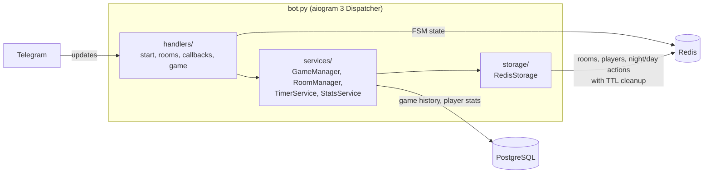

# Parilka Mafia Bot

[](https://github.com/qBrav0/parilka_mafia_bot/actions/workflows/ci.yml)


A Telegram bot for playing **Mafia** where every speech is a voice message or a
video note. Players can't edit what they said, so the game keeps the feel of a
live table. Several games run in parallel; each room is isolated by a 6-character code.

## What it does

- **Rooms:** create a room, share the code, others join; the host picks the
  player limit and (for 10+ players) the number of mafia and whether a doctor plays.
- **Roles:** Don, Mafia, Sheriff, Doctor and Civilians, distributed automatically
  by player count; mafia is always a minority.
- **Zero night:** the Don records a strategy that only the mafia hears.
- **Night:** mafia picks a target (kill happens only on a unanimous choice),
  the doctor saves, the sheriff checks a player.
- **Day:** players speak in turn with live countdown timers (the bot edits the
  timer message), nominate suspects, defend, vote, revote on ties, give a last word.
- **Shouts:** out-of-turn voice messages are allowed but penalised; the third
  one eliminates the player.
- **Statistics (optional):** finished games and per-player stats are written to PostgreSQL.

## Architecture



- **handlers** parse Telegram updates (commands, inline buttons, voice/video notes)
  and hold no game rules.
- **services** hold the game logic: role distribution, night resolution, vote
  counting, win conditions, timers as `asyncio` tasks.
- **storage** is a thin async Redis layer. Rooms expire after 30 minutes of
  inactivity, so abandoned games clean themselves up.
- Messages to all players are broadcast with per-recipient error handling and a
  small delay to stay under Telegram rate limits.

Full game specification (in Ukrainian): [docs/SPECIFICATION.uk.md](docs/SPECIFICATION.uk.md).

## Tech stack

Python 3.12 · aiogram 3 · asyncio · Redis (game state + FSM) · PostgreSQL / asyncpg
(statistics) · Docker Compose · pytest + fakeredis · ruff · GitHub Actions

## Run it

```bash
cp .env.example .env        # put your BOT_TOKEN from @BotFather here
docker compose up --build   # bot + Redis + PostgreSQL
```

Without Docker:

```bash
pip install -r requirements.txt
python bot.py               # needs a running Redis; DATABASE_URL is optional
```

## Tests

```bash
pip install -r requirements-dev.txt
ruff check .
pytest
```

The tests run the game engine against an in-memory Redis (fakeredis): role
distribution for 6–15 players, night resolution (unanimous kill, split vote,
doctor save, sheriff check), voting and ties, win conditions, shout penalties
and the room lifecycle. CI runs lint and tests on every push.

## What I would improve next

- Move per-room timers from in-process `asyncio` tasks to Redis-backed
  scheduling, so a restart doesn't lose running countdowns.
- Split `handlers/callbacks.py` by game phase; it grew as features were added.
- Add handler-level tests with a mocked Bot API.
- Translate bot messages (currently Ukrainian) via i18n.

## License

[MIT](LICENSE)
